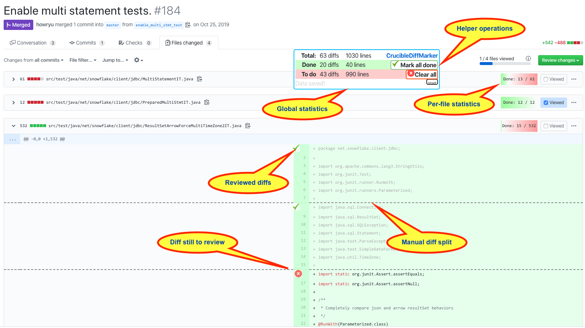
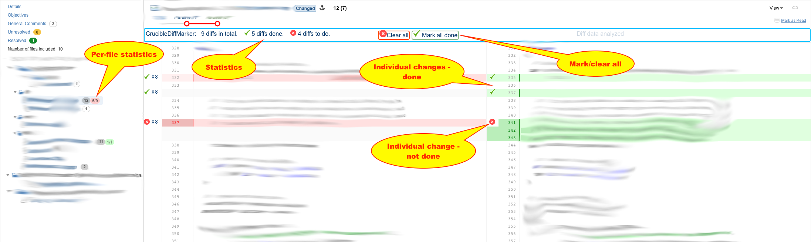

# Review Pal

A small browser extension (Chrome and Firefox) for GitHub and [Crucible](https://www.atlassian.com/software/crucible)
that adds ability to mark individual changes (diff sections) 
inside a file as done / not done. 

It also allows splitting diffs into smaller sections (and marking them separately)
and has a few other nice improvements.

It is super useful when reviewing complex diffs, PRs with a lot of changes, or with very large changes.

## Functionality

* Mark individual changes as done / not done
* Manually break a change into smaller changes
  * How: Middle-click or ALT+click on the (2nd or later) line in a change to split or unsplit
  * Very useful for splitting huge changes (or entire new files) into smaller review units 
* Jump to the next done / todo change.
  * How: Click on "X diffs done" or "Y diffs to do" 
* Mark all changes as done/not done
  * in GitHub: per-file and globally
  * In Crucible: per-file only
* Fold/unfold all files (*GitHub only*)
* Hide/show all comments (*GitHub only*)
* Review statistics (number of diffs and lines)
* Keyboard shortcuts:
  * `shift+K` - next unreviewed diff
  * `shift+ctrl+K` - next diff
  * `shift+X`, `shift+ctrl+X` - mark diff reviewed / unreviewed
* Ability to highlight multiple words with double-click, up to 8 different highlights. (*GitHub only*)
  * How: Double click on a word to add/remove. Double click on an empty space to remove all. 
* Jump to the next/previous occurrence of any highlighted word
  * How: Middle-click (+ SHIFT) on a highlighted word in the top menu for the next (previous) occurrence.
* Displaying the text indent level
* Local browser persistence

#### GitHub limitations

* Both the classic diff view and the new React-based view (the ``/pull/N/changes``
  URLs GitHub is rolling out) are supported; the flavor is auto-detected.
  * In the new view, fold/unfold-all and hide/show-comments are not supported yet.
* Only works in split view currently (if I get enough requests, will add unified view support)
* When watching the same PR with a different subset of commits, the same "diff" (same changed lines)
  might not be recognized as such, as they might have different positions (line numbers) in the file.
  So e.g. marking a diff as done when reviewing a single commit 
  might not be reflected in all-commits review.

#### Crucible only

* Automatically marking entire-file as reviewed once individual changes are reviewed
* Works in both unified and side-by-side views
* Tracking per-file statistics of individual changes

#### Disclaimer

* Only matches these URLs:
  * ``https://*/fisheye/cru/*``
  * ``https://github.com/*/pull/*/*``
  
  Modify manifest.json if your Crucible is installed somewhere else.
  
* Crucible backend is not maintained anymore
  * Only tested on Crucible 4.5

## Installation

Currently, this extension is only available as a source code. 

To install it in Chrome:
* Go to ``chrome://extensions/``
* Enable "Developer mode"
* Click "Load unpacked"
* Point to the ``src`` directory in this tree
* Reload the GitHub/Crucible page
* Done

To install it in Firefox (140+):
* Go to ``about:debugging#/runtime/this-firefox``
* Click "Load Temporary Add-on..."
* Point to ``src/manifest.json`` in this tree
* Reload the GitHub/Crucible page
* Done

Note: a temporary add-on is removed when Firefox restarts.
For a permanent install, the extension needs to be signed —
either via [addons.mozilla.org](https://addons.mozilla.org)
(self-distribution / unlisted is fine), or use Firefox
Developer Edition / ESR with ``xpinstall.signatures.required``
set to ``false`` in ``about:config`` and install the zipped
``src`` directory via ``about:addons``.

## History

This project used to be called `crucible-diff-marker`,
as it was originally developed for Crucible.
That backend is not maintained anymore, but it might still work.

The first version was a result of roughly a day of work, it was fun to go blindly where I never ventured before 
(Chrome extensions, understanding Crucible pages, and refreshing JS a bit...).

## Example screenshots

#### GitHub

#### Crucible

